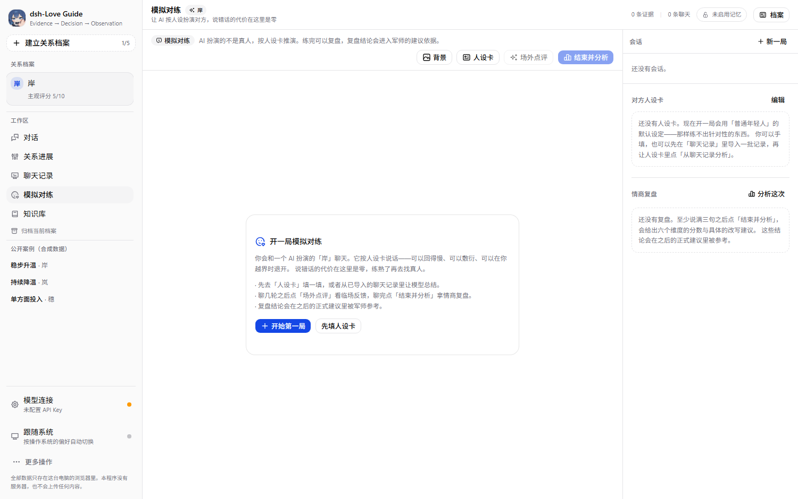

# dsh-Love Guide

一个跑在你自己电脑上的关系决策助手。把 [goutoujunshi](https://github.com/shengjidaguai-china/goutoujunshi) 那套方法论做成一个独立程序：自带 43 篇知识库检索、可以填任意兼容 OpenAI 协议的模型 API、把聊天记录画成能推演的 K 线，还有一栏「模拟对练」让你先在零代价的环境里练手。

没有服务器、不注册、不登录。所有数据只留在这台电脑上。

```
Evidence → Decision → Observation
```

## 下载

**Windows 10 / 11 x64 → [`dsh-Love-Guide-Setup-0.1.0.exe`](https://github.com/Am1ya-114514/dsh-love-guide/releases/latest)（107 MB）**

- 非一键安装：先选「仅为我 / 为所有用户」，再选安装盘符，最后一页会摆出**真实落地路径**。
- 数据放在安装目录旁边的 `dsh-love-guide-data\`，**卸载不会删除**，重装或换版本都还能读到。
- 不想安装也可以自己构建免安装的绿色版，见下面「自己构建」。
- 系统会提示「未知发布者」：这是没有代码签名证书的开源项目，源码就在本仓库，可自行比对。

**Android 7.0 及以上 → APK 见 [Releases](https://github.com/Am1ya-114514/dsh-love-guide/releases/latest)。**

- 窄屏会自动把左侧栏收进抽屉，右上角汉堡菜单打开。除此之外与桌面版是同一套代码、同一套数据模型。
- 手机上装完就没有服务器什么事了：API 请求由手机直连你填的那个模型服务商。
- **导出的 JSON 走系统分享面板**（保存到「文件」或发给别人），而不是桌面版的浏览器下载。

## 界面

| 模拟对练 | 关系进展 |
| --- | --- |
|  |  |

| 对话 | 聊天记录 |
| --- | --- |
|  |  |

界面里没有任何 emoji，图标统一用 [@tabler/icons-react](https://tabler.io/icons)。

## 功能

| 模块 | 说明 |
| --- | --- |
| 对话 | 五步结构：承接情绪 → 已记录的事实 → 合理推测 → 仍然未知 → 下一步。下一步会渲染成行动卡：动作 + 观察窗口 + 停止条件 + 可直接复制的话术 |
| 关系进展 | 把证据按「方向 × 完整度 × 证据等级」加权成水位，聚合成 K 线（红涨绿跌、灰=证据不足），带均线、六项指标与证据台账 |
| 聊天记录 | 三步导入：先干跑只报格式与条数 → 确认说话人映射 → 再入库。支持纯文本 / `名字：内容` / ChatLab JSON，也可以导入聊天截图交给你自己填的视觉模型转写 |
| 模拟对练 | 让 AI 按「对方人设卡」扮演那个人跟你练。人设卡可手填，也可从已导入的聊天记录里抽；支持自定义聊天背景；随时可以要一句场外点评，聊完给六维复盘（共情承接 / 表达清晰 / 边界与自尊 / 主动推进 / 节奏分寸 / 冲突修复）与逐句改写建议，复盘结论会进入之后正式建议的上下文 |
| 知识库 | 检索 43 篇材料、命中片段与出处、全文弹窗呈现 |
| 设置 | 模型连接（7 个预设 + 自定义）、长期记忆开关、导出/清空本机数据 |

## 自己构建

需要 Node.js ≥ 22.19 与 pnpm。

```bash
pnpm install
pnpm app:build        # 绿色版 → 输出到仓库上两级的 dsh-Love-Guide\
pnpm app:installer    # 安装包 → .runtime\installer\
pnpm android:apk      # Android APK → .runtime\apk\
```

`dev` / `build` 之前会自动把 `knowledge/` 下的 43 篇 Markdown 编译成 TS 产物。打包用的 Electron 临时文件与缓存全部落在仓库内的 `.runtime\`，不碰系统临时目录。

换图标：把新图放进 `build/icon-source.webp`，跑 `python build/make-icon.py`（需要 Pillow），一次生成 exe 图标、favicon 与界面里的品牌标记；`python build/make-android-art.py` 另外把 Android 的 `mipmap-*` 与启动图直接写到 `android/app/src/main/res/`。

打 APK 需要 JDK 21 与 Android SDK（`platforms;android-36`、`build-tools;36.0.0`）。`scripts/make-apk.mjs` 默认去 `F:\android-tools\` 找，也可以用 `GTJS_JDK_HOME` / `ANDROID_HOME` / `GRADLE_USER_HOME` 指到别处。想打 release 包就先按 Capacitor 文档配好签名，再跑 `pnpm android:apk --release`。

不想装这一整套 Android 工具链的话，`.github/workflows/android.yml` 会在 GitHub 的机器上打 debug 包：仓库 Actions 页手动触发，或推一个 `v*` tag，产物在该次运行的 Artifacts 里。

## 数据与隐私

- 档案、对话、证据、聊天记录全部存在本机（桌面版是 exe 旁边的数据目录，网页调试时是 IndexedDB）。重要档案请定期导出 JSON。
- **不**解密、**不**直接读取微信或 QQ 的聊天数据库，**不**绕过平台权限，**不**后台监控，**不**代你发送消息。这不是能力限制，是刻意不做的边界——解析微信数据库违反平台条款且有法律风险（腾讯对第三方自动化工具胜诉并获高额赔偿已有公开判例）。
- 可用输入：聊天软件自带的「导出聊天记录」、手动复制一段对话、截图，或 ChatLab 导出的 JSON。
- API Key 只存在本机，由程序直接请求你填的端点，没有中间服务器。想完全离线就选 Ollama。

## 它刻意不做什么

- 不预测对方爱不爱你、会不会回心转意、出轨概率、成功率。
- 不诊断心理疾病，不替代心理咨询或医疗。
- 不教操控、冷暴力、跟踪、施压；不美化单方面投入。
- 不把模型的推断写进「用户稳定档案」，推断只能进假设区。
- 不用 MBTI 决定结果，只当沟通偏好参考。
- 模拟对练里也不替你发消息，也不把模拟结果说成对真人的预测。

## 技术栈

Vite 8 · React 19 · TypeScript 6 · Tailwind v4 · [shadcn/ui](https://ui.shadcn.com) + [Base UI](https://base-ui.com)（组件源码直接进仓库）· [ECharts 6](https://echarts.apache.org) · Zustand 5 · Dexie 4 · Zod 4 · [Electron 44](https://www.electronjs.org) · [electron-builder](https://www.electron.build) 26 · [Capacitor 8](https://capacitorjs.com)。

几个值得说明的取舍：

- **不用 ECharts 的 React 封装**：`echarts-for-react` 停更且会挡住 `setOption` 语义，改成约 40 行自己管的组件。
- **不用 react-markdown**：回答渲染自己写了个极简 Markdown → React 元素转换，不做 HTML 透传，反而少一层 XSS 面。
- **桌面版不用 `file://`**：`file://` 的 origin 是 `null`，IndexedDB 直接不可用。改成主进程内起只读的 `127.0.0.1:41730`（端口固定，因为 IndexedDB 按 origin 隔离，换端口等于换数据库）。
- **安装界面手写 nsDialogs**：用 electron-builder 的 `customWelcomePage` / `customPageAfterChangeDir` 两个钩子插入欢迎页与「装到哪」确认页，这样能放圆角图标与软件名。
- **Android 版刻意不开 `CapacitorHttp`**：它把 fetch 劫持到原生栈能绕开 CORS，但会把响应整体缓冲，**流式输出直接失效**。实测 `api.deepseek.com` 对预检请求是回声式放行（连 `https://localhost` 都照放），所以 WebView 原生 fetch 走 CORS 就够了，流式保得住。
- **Android 图标不用 `@capacitor/assets`**：它依赖 sharp，为一个固定尺寸表引入原生依赖不划算；改成 `build/make-android-art.py` 直接把 `mipmap-*` 写进 res。
- **人设卡不写性格标签**：抽取提示词只允许写能核对的说话习惯（句子长短、口头禅、高频话题、回复节奏、雷区）并附原文片段，不许写「她比较冷漠」这类没法验证的判断——那种句子一旦进了提示词，AI 就会照着演。
- **模拟对练不自动发送**：开场白按钮只把文字填进输入框，按不按发送由人决定。

## 目录结构

```
electron/main.cjs          主进程：内置静态服务、便携数据目录、窗口状态、单实例
capacitor.config.ts        Android 外壳配置（origin、插件、状态栏）
android/                   Capacitor 生成的 Android 工程（图标与启动图是我们改过的，要入库）
build/
  installer.nsh            安装界面：欢迎页 + 「装到哪」确认页
  make-icon.py             从一张源图生成桌面端全部图标与品牌图
  make-android-art.py      同一张源图 → Android 自适应图标、启动图、mipmap-*
electron-builder.yml       安装包配置（NSIS、非一键、可改安装目录、中文界面）
scripts/
  build-knowledge.mjs      把 knowledge/ 的 43 篇 Markdown 编译成 TS 产物
  make-portable.mjs        打包免安装绿色版
  make-installer.mjs       打安装包，自带 EPERM rename 竞态自愈重试
  make-apk.mjs             打 APK：构建 → cap sync → gradle → 收产物
.github/workflows/
  android.yml              在 GitHub 机器上打 debug APK（手动触发或推 v* tag）
knowledge/                 上游参考资料原文（20 篇核心知识 + 23 篇实用材料，MIT）
src/
  lib/                     检索、模型客户端、指标、聊天解析、数据库、状态、提示词
  components/              各视图；sim-view.tsx 是模拟对练
  components/ui/           shadcn/ui 生成后纳入仓库的组件
```

## 与上游的关系

方法论、知识库材料与「最多 5 个对象」「证据分级」「不预测爱意」等行为边界都来自上游 [shengjidaguai-china/goutoujunshi](https://github.com/shengjidaguai-china/goutoujunshi)（MIT，Copyright (c) 2026 powerycy）。本仓库是它的独立衍生实现。上游材料是中文互联网语境的整理，其中引用的外部来源未经独立核实，请按材料自带的证据等级看待。第三方依赖许可见 [THIRD_PARTY_NOTICES.md](THIRD_PARTY_NOTICES.md)。

## 免责声明

这是沟通与决策辅助工具，不构成心理咨询、医疗、法律或任何专业意见。涉及暴力、跟踪、威胁、自伤或未成年人时，请优先寻求现实中的专业帮助与紧急救助。

## 许可

MIT，见 [LICENSE](LICENSE)。
