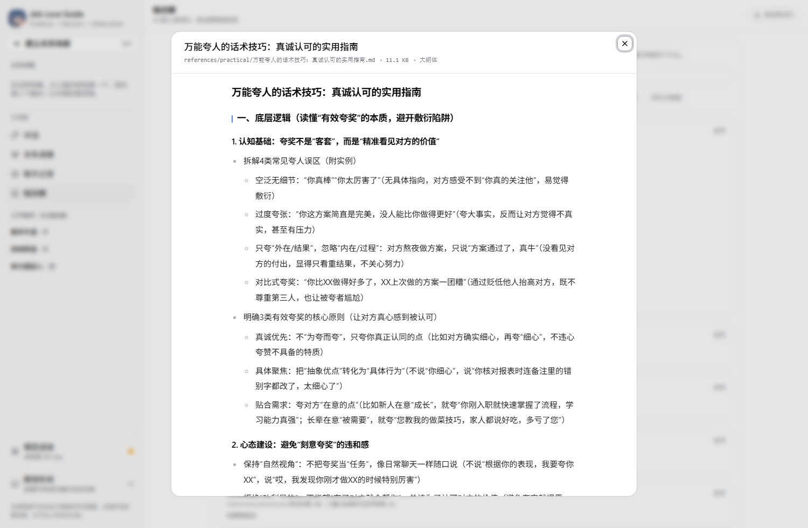
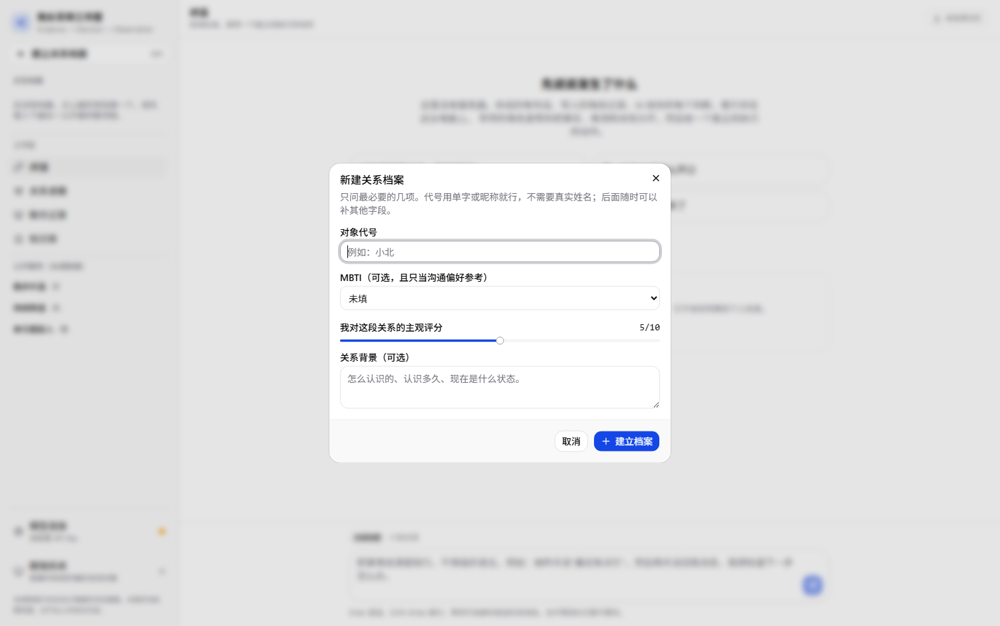
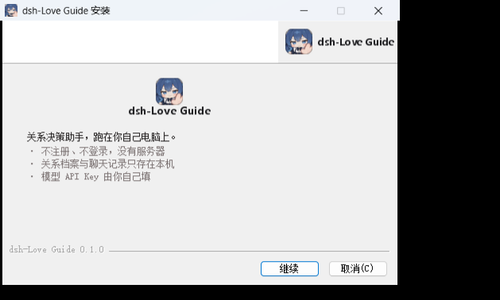
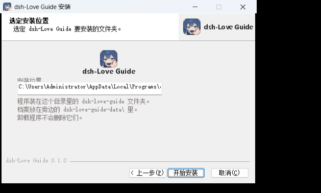

# dsh-Love Guide

把 [goutoujunshi](https://github.com/shengjidaguai-china/goutoujunshi) 那套「恋爱决策助手」的方法论，做成一个**能自己跑起来的本地程序**：自带知识库检索、可填任意兼容 OpenAI 协议的 Agent API、把聊天记录画成可推演的 K 线，并为每个对象维护独立的关系档案。

它有网页版，也有打包好的 Windows 桌面版（双击即开，不弹终端）。它不是网页版复刻，也不依赖任何后端服务——没有服务器、没有账号、没有遥测，所有数据只留在你这台电脑上。

```
Evidence → Decision → Observation
```

## 界面

| 关系进展（K 线推演） | 聊天记录导入 |
| --- | --- |
|  |  |

| 对话 | 知识库检索 |
| --- | --- |
|  |  |

| 深色主题 | 关于与数据 |
| --- | --- |
|  |  |

| 知识库全文（弹窗阅读） | 新建关系档案 |
| --- | --- |
|  |  |

界面里没有任何 emoji：图标统一用 [@tabler/icons-react](https://tabler.io/icons)，配色走 shadcn 的 oklch 令牌，证据分级另有一套专用语义色（刻意避开红绿，把红绿留给 K 线的涨跌）。

---

## 这个程序解决什么问题

上游 skill 是一个提示词工程产物：它把方法论写在 43 篇 Markdown 里，靠模型「自觉」去读、去引用。这在真实使用里有两个硬伤：

1. **模型不一定会去读**。资料躺在目录里，读不读、读到哪一篇，全凭模型当轮的判断。
2. **读了也没法核对**。回答里的说法出自哪一篇、属于哪一级证据，用户看不见。

这个程序把这两件事变成机械动作：

- **确定性检索**：每次提问都用本地打分（标题 / 文件名 / 小标题 / 正文词频，中文按单字 + 二元组切分）挑出最相关的 1–4 篇，塞进上下文，并在回答里标出出处与证据等级。
- **可视化推演**：把每条证据按「方向 × 完整度 × 证据等级」加权成水位，聚合成 K 线；只解释已经记录的证据，不预测爱意、忠诚或成功率。
- **多对象隔离**：每个对象一份独立的对话、证据、档案、聊天记录，最多同时保留 5 个（沿用上游边界）。

## 功能

| 模块 | 做了什么 |
| --- | --- |
| **对话** | 五步回答结构（承接情绪 → 已记录的事实 → 合理推测 → 仍然未知 → 下一步），下一步会渲染成行动卡：动作 + 观察窗口 + 停止条件 + 可直接复制的话术。默认用「大肥鱼」语气（像熟人聊天，不端 AI 腔），可在设置里切成「稳重的军师」 |
| **关系进展** | K 线推演图（红涨绿跌、灰=证据不足）、均线、六项指标（相位 / 可判定证据 / 平均完整度 / 距上次证据 / 净额对比 / 互惠）、证据台账（增删改 + 存疑标记） |
| **聊天记录** | 三步导入：先干跑只报格式与条数（不展示正文）→ 确认说话人映射 → 再入库。支持带时间戳的纯文本、`名字：内容`、尖括号格式与 ChatLab 导出的 JSON；**也可以直接导入聊天截图**，交给你自己填的视觉模型转成文字，再走同一套解析。入库后可按日画出双方消息量、发起/回应比例、回复节奏，并让军师基于统计写一份解读 |
| **知识库** | 检索 43 篇材料、看命中片段与出处、全文以弹窗呈现（表格渲染成表格，大纲还原缩进层次）、检查材料完整性（数量、编号连续性、空文件） |
| **模拟对练** | 让 AI 按「对方人设卡」扮演那个人跟你聊，说错话的代价是零。人设卡可以手填，也可以从已导入的聊天记录里让模型抽（只抽能核对的说话习惯：句子长短、口头禅、高频话题、回复节奏、雷区，并附原文片段）。支持自定义聊天背景图。可以随时要一句「场外点评」，聊完点「结束并分析」得到六维复盘（共情承接 / 表达清晰 / 边界与自尊 / 主动推进 / 节奏分寸 / 冲突修复）与逐句改写建议。**复盘结论会进入之后正式建议的上下文**，让军师结合你一贯的说话方式给建议 |
| **设置** | 模型连接（7 个预设 + 自定义，可拉取模型列表）、长期记忆开关（明确同意 + 可撤销）、导出/清空本机数据、来源与许可 |

## 桌面版（Windows，不用装 Node）

已经打包好的成品是一个绿色程序，解压/拷贝到哪台 Windows 机器上都能直接双击运行：

```
dsh-Love-Guide\
├─ dsh-love-guide.exe          ← 双击这个
├─ dsh-love-guide-data\        ← 你的数据（首次运行时自动创建，就在 exe 旁边）
├─ resources\app.asar          ← 前端与主进程代码
├─ resources\icon.ico          ← 程序图标（换图见下）
└─ ...（Electron 运行时）
```

- **双击就能开，不会弹出黑色终端窗口**（程序是 GUI 子系统，菜单栏也默认隐藏，按 `Alt` 才出现）。
- **不往 C 盘写东西**：数据库、缓存、窗口大小全部存在 exe 同级的 `dsh-love-guide-data\` 里。整个文件夹拷到 U 盘或别的电脑，档案跟着走。
- 快捷键：`F12` / `Ctrl+Shift+I` 开发者工具，`F5` 或 `Ctrl+R` 刷新，`Ctrl+0` / `Ctrl+=` / `Ctrl+-` 缩放。
- 程序只监听 `127.0.0.1:41730`，不对外开端口。
- 双击任务栏图标不会开出第二个窗口——第二次启动会把已有窗口叫到前面。

> 这个程序以前叫「狗头军师工作室」，数据目录也跟着叫 `goutoujunshi-data\`。改名的版本启动时会把这个旧目录**自动搬一次**到 `dsh-love-guide-data\`；万一没搬动（目录被占用），它会继续用旧目录，不会把档案丢下。

### 换图标

图标是从一张源图生成出来的，不用手改二进制：

```bash
# 把新图放到 build/icon-source.webp（正方形最好）
python build/make-icon.py     # 需要 Pillow
```

一次生成五份：`build/icon.ico`（多档尺寸，给 exe）、`build/icon.png`（512）、`public/favicon.png`、`public/apple-touch-icon.png`、`src/assets/brand.png`（界面左上角那个标记）。

自己从源码打这个包：

```bash
pnpm install
pnpm app:build        # = pnpm build + pnpm run app:pack
```

产物默认输出到仓库上两级的 `dsh-Love-Guide\`，用 `GTJS_APP_OUT` 可以改到别处。打包时 Electron 的 400MB 临时文件与缓存都落在仓库内的 `.runtime\`，不碰系统临时目录。

> 打包时偶尔会遇到 `EPERM: operation not permitted, rename ...`：刚写完的几百兆文件会被系统短暂握住句柄。`scripts/pack.mjs` 遇到这种情况不会重来（重来要再解压 400MB），而是等一会儿把已经解压好的目录自己搬到位。

## Windows 安装包

不想拷文件夹的话，也可以给用户一个标准的 `Setup.exe`：

```bash
pnpm app:installer      # = pnpm build + node scripts/make-installer.mjs
```

产物在 `.runtime\installer\dsh-Love Guide-Setup-<版本>.exe`（约 107 MB）。安装界面是定制的，用的是和应用同一套颜色与圆角图标：

| 欢迎页 | 选择安装位置之后 |
| --- | --- |
|  |  |

- 非一键安装：先选「仅为我 / 为所有用户」，再选安装目录，最后有一页把**真实落地路径**摆出来，并说明数据放在哪、卸载会不会删。
- 安装完成后可以勾选直接启动；开始菜单与桌面都建快捷方式，名字是 `dsh-Love Guide`。
- 数据仍然放在**安装目录旁边**的 `dsh-love-guide-data\`，卸载时不会删除。
- 安装包的界面文案、颜色、控件位置都写在 `build/installer.nsh`，品牌图由 `python build/make-installer-art.py` 从同一张源图生成。

> 注意：NSIS 安装程序每次运行都会先把约 477 MB 的内容解到 `%TEMP%`（也就是系统盘）再往目标目录铺，装完会自行清掉。如果中途取消或强杀进程，`%TEMP%` 里可能留下 `ns****.tmp` 目录，可以手动删。

### 下载安装包（不用自己构建）

安装包不进 Git 仓库——它 100 MB 出头，提交进去会让仓库永久膨胀、克隆变慢。它挂在 **GitHub Releases** 里，浏览器点一下就能下载：

**[→ 到 Releases 页面下载 `dsh-Love Guide-Setup-*.exe`](https://github.com/Am1ya-114514/dsh-love-guide/releases/latest)**

（Windows 可能提示「未知发布者」，因为这是没有代码签名证书的开源项目；安装包本身没有被篡改，源码就在本仓库里可自行比对构建。）

## 从源码运行（Web 版）

需要 Node.js ≥ 22.19 与 pnpm。

```bash
pnpm install
pnpm dev          # 打开 http://127.0.0.1:5273
```

生产构建与本地预览：

```bash
pnpm build
pnpm start        # 打开 http://127.0.0.1:4173
```

`dev` 与 `build` 之前会自动跑 `scripts/build-knowledge.mjs`，把知识库编译成 `src/data/knowledge.generated.ts`。若知识库不在默认位置（`../goutoujunshi/references`），用环境变量指定：

```bash
GTJS_REFERENCES=/path/to/references pnpm build
```

### 接上你自己的 API

1. 左下角 **模型连接** → 选服务商（DeepSeek / Moonshot / 智谱 / 硅基流动 / OpenAI / Ollama / 自定义）。
2. 填 API Key（选预设会同时填好 baseUrl 与模型名），可点「拉取模型列表」确认可用模型。
3. 在**数据边界**里决定要不要把检索到的资料、以及聊天原文一起发给模型。

API Key 只保存在本机浏览器的 localStorage 里，由浏览器直接请求你填的端点——程序没有自己的后端可以中转。想用完全离线的方案就选 Ollama。

## 数据与隐私

- 所有档案、对话、证据、聊天记录存在浏览器 **IndexedDB** 里；换浏览器、清缓存、用无痕窗口都可能让数据消失，重要档案请定期导出 JSON。
- **不**解密、**不**直接读取微信或 QQ 的聊天数据库，**不**绕过任何平台权限，**不**后台监控，**不**替你发送消息。这不是能力限制，是刻意不做的边界——解析微信数据库违反平台条款且有法律风险（腾讯对第三方自动化工具胜诉并获高额赔偿已有公开判例）。
- 可用的输入方式：聊天软件自带的「导出聊天记录」、手动复制一段对话、截图，或 ChatLab 导出的 JSON。
- 导出文件里包含聊天原文，请自行保管。

## 它刻意不做什么

- 不预测对方爱不爱、会不会回心转意、出轨概率、成功率。
- 不诊断心理疾病，不替代心理咨询或医疗。
- 不教操控、冷暴力、跟踪、施压；不美化单方面投入。
- 不把模型自己的推断写进「用户稳定档案」——推断只能进假设区。
- 不用 MBTI 决定结果（MBTI 只当沟通偏好参考）。
- 不在模拟对练里替你发消息，也不把模拟结果说成对真人的预测——那是你说话方式的复盘。

## 技术栈

Vite 8 · React 19 · TypeScript 6 · Tailwind v4 · [shadcn/ui](https://ui.shadcn.com)（base preset，组件源码直接进仓库）· [Base UI](https://base-ui.com) · [@tabler/icons-react](https://tabler.io/icons)（界面图标，不用 emoji）· [ECharts 6](https://echarts.apache.org)（按需引入）· Zustand 5 · Dexie 4 · Zod 4 · oxlint · [Electron 44](https://www.electronjs.org)（桌面外壳，仅打包时用到）· [electron-builder](https://www.electron.build) 26（Windows 安装包，仅打包时用到）。

几个值得说明的取舍：

- **不引入 ECharts 的 React 封装**：`echarts-for-react` 停更且会挡住 `setOption` 语义，改成约 40 行的 `EChart` 组件（`init` + `ResizeObserver` + `dispose` 全程自己管）。
- **不引入 react-markdown**：回答渲染自己写了个极简 Markdown → React 元素的转换，不做 HTML 透传，反而少一层 XSS 面。
- **聊天记录不进 localStorage**：localStorage 同步阻塞且同源容量约 5 MB，只用来放配置项。
- **生产构建注入 CSP**（`script-src 'self'`），所以主题系统没有用 next-themes——它靠注入内联脚本防闪烁，会被 CSP 拦掉；这里改成渲染前同步读 localStorage。
- **桌面版不用 `file://` 加载页面**：`file://` 的 origin 是 `null`，IndexedDB 会直接不可用。改成主进程内起一个只读的 `127.0.0.1:41730` 静态服务（端口固定，因为 IndexedDB 按 origin 隔离，换端口等于换数据库）。
- **`app.setPath('userData')` 必须排在 `requestSingleInstanceLock()` 前面**：单实例锁会在 userData 里落一个 lockfile，顺序反了它就会在 `%APPDATA%` 留下目录，破坏「不往 C 盘写」。
- **「大肥鱼」只写在语气层**：提示词里把硬边界（不断言对方心意、不预测成功率、不鼓励操控）标成「优先级高于说话风格」。风格只决定怎么说，不决定能说什么——否则模型会为了「像大肥鱼」而随口替用户下结论，那恰好是这个程序最不能犯的错。
- **聊天截图先转文字，再走同一套解析**：不给解析器加一条「图片分支」，而是让视觉模型把截图转成与粘贴格式一致的文本，下游的干跑 / 说话人映射 / 指标 / 画图一行都不用改。一次只发一张图，避免结果被 `max_tokens` 截断——截断的中间部分最难发现。
- **安装界面用 `build/installer.nsh` 手写 nsDialogs 页面**：electron-builder 的 `customWelcomePage` / `customPageAfterChangeDir` 两个钩子插在安装模式页与安装进度页之间，正好是「准备安装、选路径」这一段。注意这个 nsh 被 include 的位置比 `MUI2.nsh` 还早，所以里面**不能用 `!insertmacro MUI_HEADER_TEXT` 之类的 MUI 宏**，只能用 nsDialogs 插件命令加硬编码常量。
- **装包脚本自己兜 EPERM**：`scripts/make-installer.mjs` 会在失败后扫描缓存与输出目录里卡住的 `*.tmp` 并自己搬正（这台机器上「刚解压完就 rename」会偶发占用），撤不掉就清掉半成品重跑，最多 4 次。
- **模拟对练不自动发送**：开场白按钮只把文字**填进输入框**，按不按发送由人决定。给一个「AI 替你去聊」的默认行为，迟早会有人拿没审过的句子发出去。
- **人设卡不写性格标签**：抽取提示词明确要求只写能核对的说话习惯（句子长短、口头禅、高频话题、回复节奏、雷区）并附原文片段，不许写「她比较冷漠」这类没法验证的判断——那种句子一旦进了提示词，AI 就会照着演，用户也拿它没辙。

## 目录结构

```
scripts/
  build-knowledge.mjs 把 knowledge/ 下的 43 篇 Markdown 编译成 TS 产物
  pack.mjs            组一个最小暂存目录并打包成 Windows 桌面程序（绿色版）
  make-installer.mjs  打 Windows 安装包，自带 EPERM rename 竞态的自愈重试
electron/
  main.cjs            主进程：内置静态服务、便携数据目录、窗口状态、单实例
build/
  make-icon.py        用 Pillow 画狗头图标，生成 icon.ico 与 icon.png
  make-installer-art.py  从同一张源图生成安装界面用的三张 BMP
  installer.nsh       安装界面：欢迎页 + 「装到哪」确认页
electron-builder.yml  安装包配置（NSIS、非一键、可改安装目录、中文界面）
knowledge/            上游参考资料原文（20 篇核心知识 + 23 篇实用材料，MIT）
src/
  lib/
    knowledge.ts      确定性中文检索（分词、同义词、打分、摘录）
    ai.ts             兼容 OpenAI 协议的流式客户端（SSE 手写解析）+ 截图转写
    metrics.ts        纯函数指标层：K 线聚合、均线、互惠、相位
    chatlog.ts        聊天记录解析（多种格式 → 结构化行 + 说话人建议）
    db.ts             Dexie 表结构（含模拟对练的会话 / 消息 / 背景图 / 复盘）
    store.ts          Zustand 全局状态与动作
    prompt.ts         把上游硬约束写成系统提示词（含「大肥鱼」语气层、人设抽取、情商复盘）
    brand.ts          应用名与口号，集中一处
    theme-mode.ts     明暗主题（不依赖内联脚本）
  components/         各视图与自建组件
    sim-view.tsx      模拟对练（人设扮演、背景图、场外点评、六维复盘）
    sim-persona-dialog.tsx  对方人设卡编辑器（手填 / 从聊天记录抽）
  components/ui/      shadcn/ui 生成后纳入仓库的组件
  data/               knowledge.generated.ts（由脚本生成）
```

知识库源目录按 `GTJS_REFERENCES` → 本仓库 `knowledge/` → 同级 `../goutoujunshi/references` 的顺序查找，克隆下来无需额外配置即可构建。

## 与上游的关系

方法论、知识库材料与「最多 5 个对象」「证据分级」「不预测爱意」等行为边界都来自上游 [shengjidaguai-china/goutoujunshi](https://github.com/shengjidaguai-china/goutoujunshi)（MIT，Copyright (c) 2026 powerycy）。本仓库是它的独立衍生实现，`references/` 下 43 篇 Markdown 原文按 MIT 条款收录并编译进 `src/data/knowledge.generated.ts`。

上游参考资料是中文互联网语境的整理，其中引用的外部来源未经第三方独立核实，请按材料自带的证据等级看待。第三方依赖许可见 [THIRD_PARTY_NOTICES.md](THIRD_PARTY_NOTICES.md)。

## 免责声明

这是沟通与决策辅助工具，不构成心理咨询、医疗、法律或任何专业意见。涉及暴力、跟踪、威胁、自伤或未成年人时，请优先寻求现实中的专业帮助与紧急救助。

## 许可

MIT，见 [LICENSE](LICENSE)。
