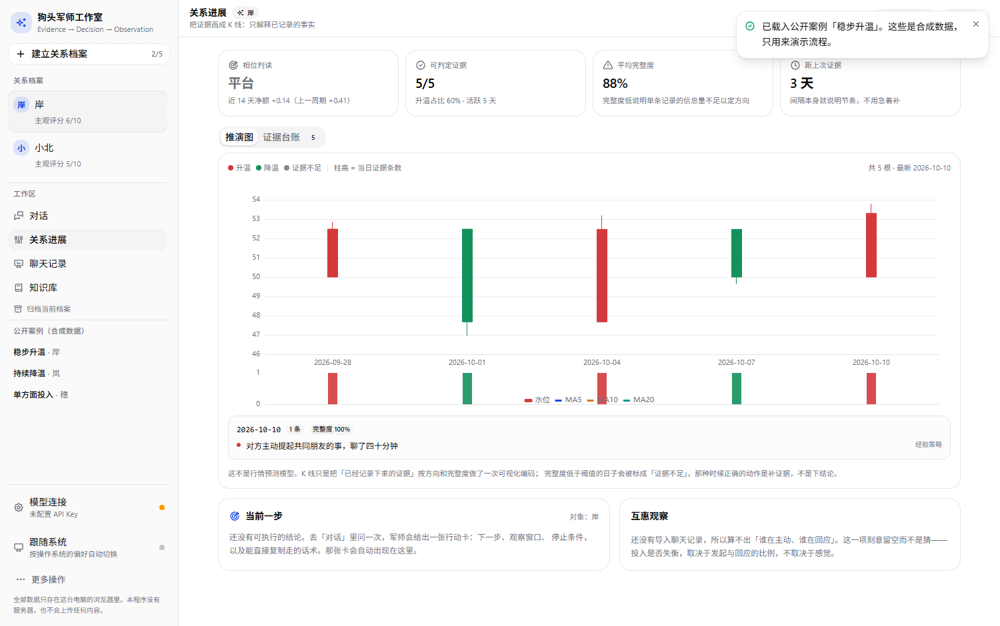
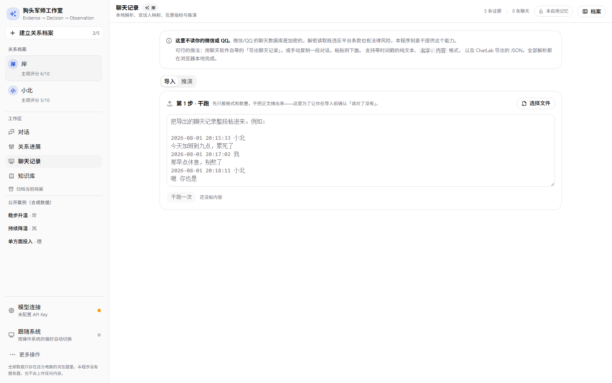
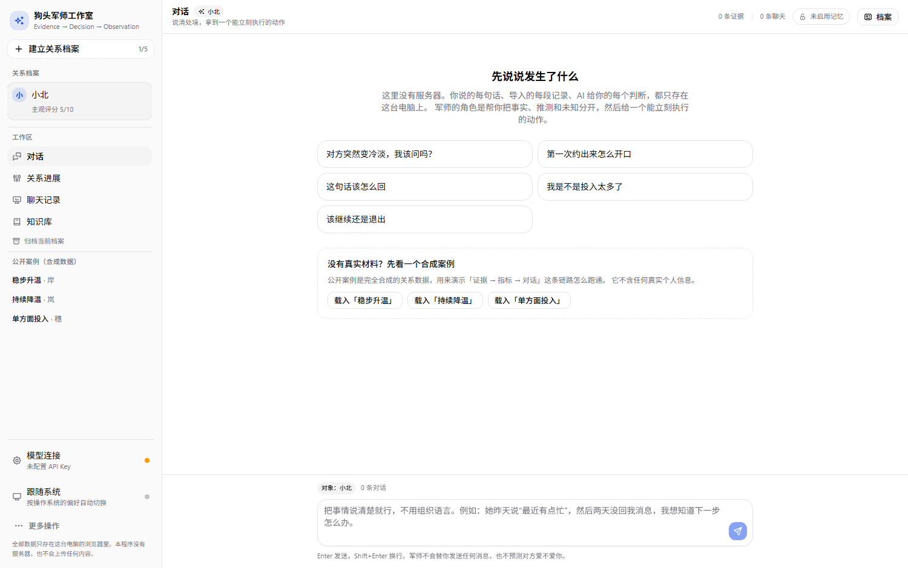
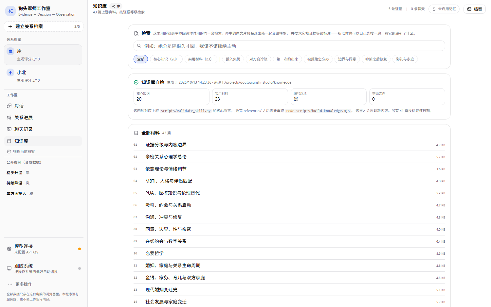
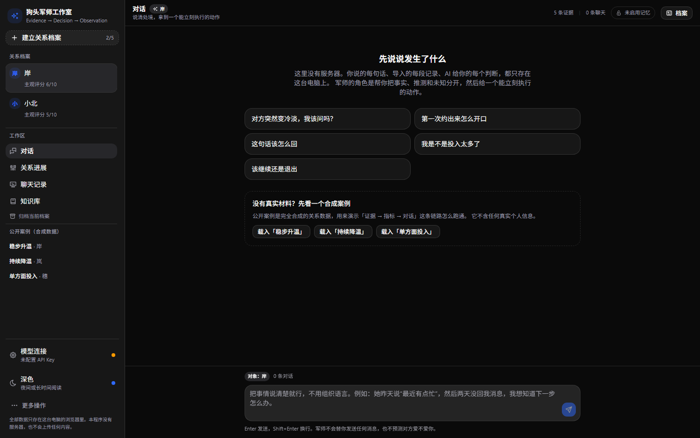
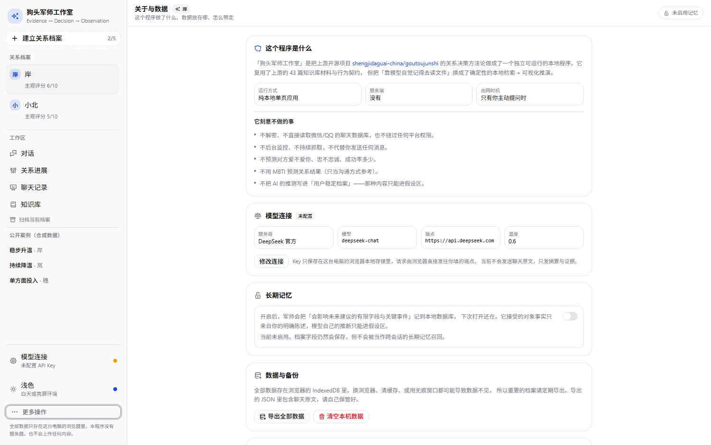

# 狗头军师工作室 · goutoujunshi-studio

把 [goutoujunshi](https://github.com/shengjidaguai-china/goutoujunshi) 那套「恋爱决策助手」的方法论，做成一个**能自己跑起来的本地程序**：自带知识库检索、可填任意兼容 OpenAI 协议的 Agent API、把聊天记录画成可推演的 K 线，并为每个对象维护独立的关系档案。

它不是网页版复刻，也不依赖任何后端服务——没有服务器、没有账号、没有遥测，所有数据只留在你这台电脑的浏览器里。

```
Evidence → Decision → Observation
```

## 界面

| 关系进展（K 线推演） | 聊天记录导入 |
| --- | --- |
|  |  |

| 对话 | 知识库检索 |
| --- | --- |
|  |  |

| 深色主题 | 关于与数据 |
| --- | --- |
|  |  |

界面里没有任何 emoji：图标统一用 [@tabler/icons-react](https://tabler.io/icons)，配色走 shadcn 的 oklch 令牌，证据分级另有一套专用语义色（刻意避开红绿，把红绿留给 K 线的涨跌）。

---

## 这个程序解决什么问题

上游 skill 是一个提示词工程产物：它把方法论写在 43 篇 Markdown 里，靠模型「自觉」去读、去引用。这在真实使用里有两个硬伤：

1. **模型不一定会去读**。资料躺在目录里，读不读、读到哪一篇，全凭模型当轮的判断。
2. **读了也没法核对**。回答里的说法出自哪一篇、属于哪一级证据，用户看不见。

这个程序把这两件事变成机械动作：

- **确定性检索**：每次提问都用本地打分（标题 / 文件名 / 小标题 / 正文词频，中文按单字 + 二元组切分）挑出最相关的 1–4 篇，塞进上下文，并在回答里标出出处与证据等级。
- **可视化推演**：把每条证据按「方向 × 完整度 × 证据等级」加权成水位，聚合成 K 线；只解释已经记录的证据，不预测爱意、忠诚或成功率。
- **多对象隔离**：每个对象一份独立的对话、证据、档案、聊天记录，最多同时保留 5 个（沿用上游边界）。

## 功能

| 模块 | 做了什么 |
| --- | --- |
| **对话** | 五步回答结构（承接情绪 → 已记录的事实 → 合理推测 → 仍然未知 → 下一步），下一步会渲染成行动卡：动作 + 观察窗口 + 停止条件 + 可直接复制的话术 |
| **关系进展** | K 线推演图（红涨绿跌、灰=证据不足）、均线、六项指标（相位 / 可判定证据 / 平均完整度 / 距上次证据 / 净额对比 / 互惠）、证据台账（增删改 + 存疑标记） |
| **聊天记录** | 三步导入：先干跑只报格式与条数（不展示正文）→ 确认说话人映射 → 再入库。支持带时间戳的纯文本、`名字：内容`、尖括号格式与 ChatLab 导出的 JSON。入库后可按日画出双方消息量、发起/回应比例、回复节奏，并让军师基于统计写一份解读 |
| **知识库** | 检索 43 篇材料、看命中片段与出处、检查材料完整性（数量、编号连续性、空文件） |
| **设置** | 模型连接（7 个预设 + 自定义，可拉取模型列表）、长期记忆开关（明确同意 + 可撤销）、导出/清空本机数据、来源与许可 |

## 快速开始

需要 Node.js ≥ 22.19 与 pnpm。

```bash
pnpm install
pnpm dev          # 打开 http://127.0.0.1:5273
```

生产构建与本地预览：

```bash
pnpm build
pnpm start        # 打开 http://127.0.0.1:4173
```

`dev` 与 `build` 之前会自动跑 `scripts/build-knowledge.mjs`，把知识库编译成 `src/data/knowledge.generated.ts`。若知识库不在默认位置（`../goutoujunshi/references`），用环境变量指定：

```bash
GTJS_REFERENCES=/path/to/references pnpm build
```

### 接上你自己的 API

1. 左下角 **模型连接** → 选服务商（DeepSeek / Moonshot / 智谱 / 硅基流动 / OpenAI / Ollama / 自定义）。
2. 填 API Key（选预设会同时填好 baseUrl 与模型名），可点「拉取模型列表」确认可用模型。
3. 在**数据边界**里决定要不要把检索到的资料、以及聊天原文一起发给模型。

API Key 只保存在本机浏览器的 localStorage 里，由浏览器直接请求你填的端点——程序没有自己的后端可以中转。想用完全离线的方案就选 Ollama。

## 数据与隐私

- 所有档案、对话、证据、聊天记录存在浏览器 **IndexedDB** 里；换浏览器、清缓存、用无痕窗口都可能让数据消失，重要档案请定期导出 JSON。
- **不**解密、**不**直接读取微信或 QQ 的聊天数据库，**不**绕过任何平台权限，**不**后台监控，**不**替你发送消息。这不是能力限制，是刻意不做的边界——解析微信数据库违反平台条款且有法律风险（腾讯对第三方自动化工具胜诉并获高额赔偿已有公开判例）。
- 可用的输入方式：聊天软件自带的「导出聊天记录」、手动复制一段对话、截图，或 ChatLab 导出的 JSON。
- 导出文件里包含聊天原文，请自行保管。

## 它刻意不做什么

- 不预测对方爱不爱、会不会回心转意、出轨概率、成功率。
- 不诊断心理疾病，不替代心理咨询或医疗。
- 不教操控、冷暴力、跟踪、施压；不美化单方面投入。
- 不把模型自己的推断写进「用户稳定档案」——推断只能进假设区。
- 不用 MBTI 决定结果（MBTI 只当沟通偏好参考）。

## 技术栈

Vite 8 · React 19 · TypeScript 6 · Tailwind v4 · [shadcn/ui](https://ui.shadcn.com)（base preset，组件源码直接进仓库）· [Base UI](https://base-ui.com) · [@tabler/icons-react](https://tabler.io/icons)（界面图标，不用 emoji）· [ECharts 6](https://echarts.apache.org)（按需引入）· Zustand 5 · Dexie 4 · Zod 4 · oxlint。

几个值得说明的取舍：

- **不引入 ECharts 的 React 封装**：`echarts-for-react` 停更且会挡住 `setOption` 语义，改成约 40 行的 `EChart` 组件（`init` + `ResizeObserver` + `dispose` 全程自己管）。
- **不引入 react-markdown**：回答渲染自己写了个极简 Markdown → React 元素的转换，不做 HTML 透传，反而少一层 XSS 面。
- **聊天记录不进 localStorage**：localStorage 同步阻塞且同源容量约 5 MB，只用来放配置项。
- **生产构建注入 CSP**（`script-src 'self'`），所以主题系统没有用 next-themes——它靠注入内联脚本防闪烁，会被 CSP 拦掉；这里改成渲染前同步读 localStorage。

## 目录结构

```
scripts/
  build-knowledge.mjs 把 knowledge/ 下的 43 篇 Markdown 编译成 TS 产物
knowledge/            上游参考资料原文（20 篇核心知识 + 23 篇实用材料，MIT）
src/
  lib/
    knowledge.ts      确定性中文检索（分词、同义词、打分、摘录）
    ai.ts             兼容 OpenAI 协议的流式客户端（SSE 手写解析）
    metrics.ts        纯函数指标层：K 线聚合、均线、互惠、相位
    chatlog.ts        聊天记录解析（多种格式 → 结构化行 + 说话人建议）
    db.ts             Dexie 表结构
    store.ts          Zustand 全局状态与动作
    prompt.ts         把上游硬约束写成系统提示词
    theme-mode.ts     明暗主题（不依赖内联脚本）
  components/         各视图与自建组件
  components/ui/      shadcn/ui 生成后纳入仓库的组件
  data/               knowledge.generated.ts（由脚本生成）
```

知识库源目录按 `GTJS_REFERENCES` → 本仓库 `knowledge/` → 同级 `../goutoujunshi/references` 的顺序查找，克隆下来无需额外配置即可构建。

## 与上游的关系

方法论、知识库材料与「最多 5 个对象」「证据分级」「不预测爱意」等行为边界都来自上游 [shengjidaguai-china/goutoujunshi](https://github.com/shengjidaguai-china/goutoujunshi)（MIT，Copyright (c) 2026 powerycy）。本仓库是它的独立衍生实现，`references/` 下 43 篇 Markdown 原文按 MIT 条款收录并编译进 `src/data/knowledge.generated.ts`。

上游参考资料是中文互联网语境的整理，其中引用的外部来源未经第三方独立核实，请按材料自带的证据等级看待。第三方依赖许可见 [THIRD_PARTY_NOTICES.md](THIRD_PARTY_NOTICES.md)。

## 免责声明

这是沟通与决策辅助工具，不构成心理咨询、医疗、法律或任何专业意见。涉及暴力、跟踪、威胁、自伤或未成年人时，请优先寻求现实中的专业帮助与紧急救助。

## 许可

MIT，见 [LICENSE](LICENSE)。
